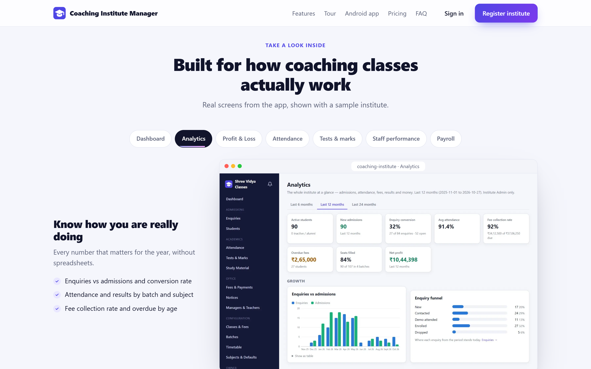
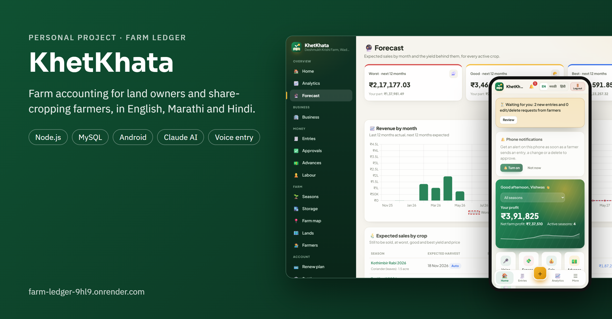
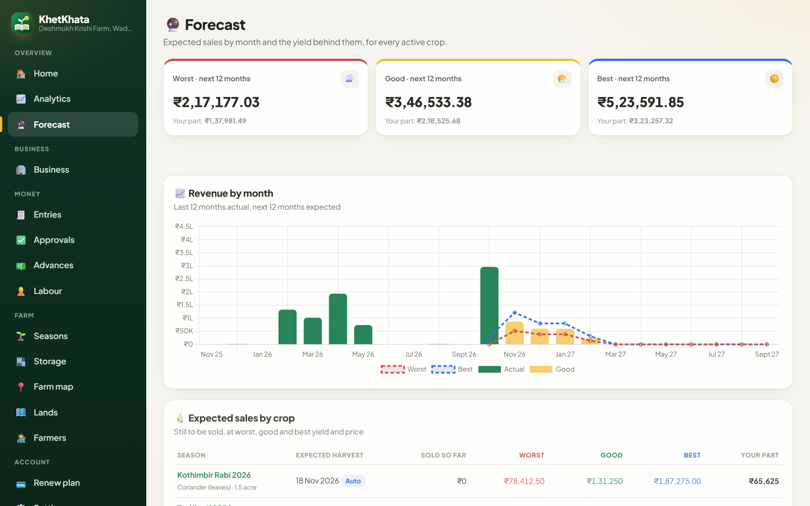
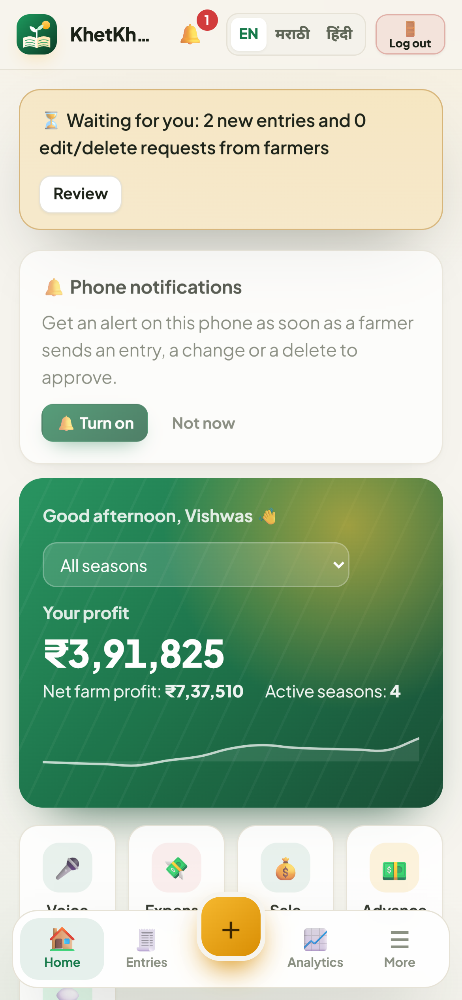
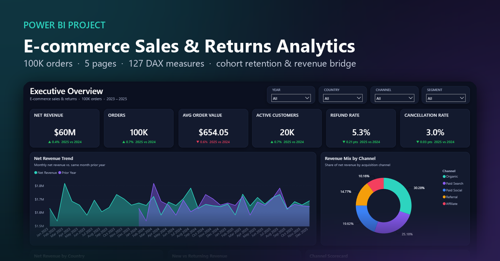

# Hi, I'm Kaiwalya Muley 👋

**Finance & BI analyst who builds data products end to end.** I automate finance reporting with Power BI, Python and SQL by day, and build full-stack apps for real businesses on the side.

[LinkedIn](https://www.linkedin.com/in/kaiwalyamuley) · kaiwalya.muley@outlook.com · Majalgaon, Maharashtra, India

---

## 🚀 Featured projects

### 🎓 CIMS: Coaching Institute Management System

A multi-institute SaaS for coaching classes: many institutes on one deployment, each with isolated data.

- Role-based access for Super Admin, Institute Admin, Manager, Teacher, Student and Parent, enforced with Postgres Row-Level Security
- Enquiries → admissions, batches and timetables, attendance, tests with ranks, fee plans, installments and receipts
- One-tap WhatsApp alerts to parents for absences, results, fee reminders and receipts
- Owner finance & analytics: payroll, expenses, profit & loss, staff performance, enquiry conversion, fee collection rate
- Android app with phone notifications

**Stack:** Next.js 15 · React · TypeScript · Supabase (Postgres, Auth, Storage) · Vercel · Capacitor
**Live:** [coaching-institute-two-iota.vercel.app](https://coaching-institute-two-iota.vercel.app)

  
  

### 🌾 KhetKhata (Farm Ledger): farm accounting in English, Marathi and Hindi

For land owners who work their land with share-cropping farmers: every season's income and expenses, split by each farmer's share.

- Advances, settlements and owner approval of farmers' entries; WhatsApp statements and PDF reports
- Analytics by crop, land and period: profit and cost per acre, margin, break-even price, financial-year views
- Automatic crop forecast (worst / good / best) from crop norms, farm history, spending and live weather, with an optional AI review by Claude
- Business view with cash & bank accounts, loans, assets and a balance sheet; labour day sheets; storage stock
- Voice entry and an Android app

**Stack:** JavaScript · Node.js · MySQL · Render · Capacitor · Claude API
**Live:** [farm-ledger-9hl9.onrender.com](https://farm-ledger-9hl9.onrender.com)

  
  

### 📊 E-commerce Sales & Returns Analytics (Power BI)

5-page Power BI report on 100,000 orders (2023–2025): star schema in Power Query, 127 DAX measures, cohort retention, revenue bridge and refund leakage.

---

## 🧰 Toolkit

**BI & analytics:** Power BI · DAX · Power Query · Advanced Excel · VBA · Power Automate
**Data:** SQL · MySQL · PostgreSQL · Python
**Apps:** JavaScript · TypeScript · Node.js · Next.js · React · Supabase · Capacitor (Android)
**Finance:** FP&A · MIS reporting · budgeting & forecasting · GST reconciliation · Tally

---

Source for CIMS and KhetKhata is private; screenshots use sample data. Happy to walk through the code on request.
